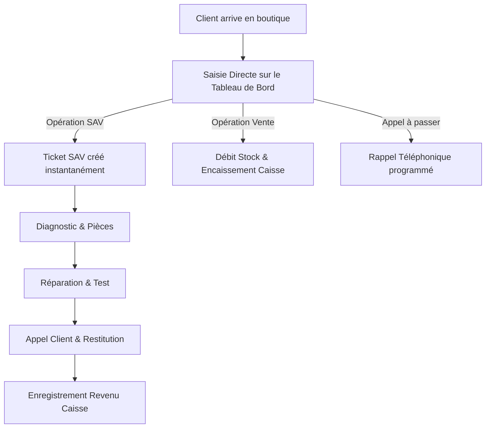

# 📖 Manuel d'Utilisation Officiel : Boutique Informatique & SAV

Ce guide exhaustif détaille l'utilisation quotidienne et avancée de l'application **Boutique Informatique & SAV**, spécialement conçue pour la gestion complète d'un magasin de vente de matériel/pièces électroniques et de son atelier de réparation (SAV).

---

## 📑 Sommaire

1. [Vue d'Ensemble & Architecture](#1-vue-densemble--architecture)
2. [Lancement de l'Application](#2-lancement-de-lapplication)
3. [Saisie Directe Client sur le Tableau de Bord](#3-saisie-directe-client-sur-le-tableau-de-bord)
4. [Le Tableau de Bord Atelier & Flux Technique (SAV)](#4-le-tableau-de-bord-atelier--flux-technique-sav)
5. [Module SAV & Réparations](#5-module-sav--réparations)
6. [Module Inventaire & Stock Informatique](#6-module-inventaire--stock-informatique)
7. [Module Point de Vente & Caisse (Ventes Comptoir)](#7-module-point-de-vente--caisse-ventes-comptoir)
8. [Module Finances & Caisse (Dépenses & Revenus)](#8-module-finances--caisse-dépenses--revenus)
9. [Module Revendeurs, Grossistes & Fournisseurs](#9-module-revendeurs-grossistes--fournisseurs)
10. [Système de Rappel lors des Appels Téléphoniques](#10-système-de-rappel-lors-des-appels-téléphoniques)
11. [Persistance des Données & Réplication Automatique](#11-persistance-des-données--réplication-automatique)
12. [Installation Unique (1 PC) & Accès Multi-Postes par Raccourci Réseau](#12-installation-unique-1-pc--accès-multi-postes-par-raccourci-réseau)
13. [Génération de l'Exécutable Windows (.exe)](#13-génération-de-lexécutable-windows-exe)

---

## 1. Vue d'Ensemble & Architecture

L'application répond à l'ensemble des activités d'un commerce d'informatique, de téléphonie et d'électronique :
- **L'Atelier SAV** : Prise en charge des PC fixes, laptops, téléphones, tablettes, imprimantes et composants en panne, diagnostic, attribution technicien et restitution.
- **La Caisse & Vente Comptoir** : Gestion du stock de pièces détachées (CPU, GPU, RAM, SSD, écrans, chargeurs...), vente au comptoir avec décrémentation automatique du stock et impression des tickets.
- **Le Suivi Financier Global** : Module complet d'enregistrement des flux d'argent (entrées/sorties, loyer boutique, salaires techniciens, achats matériel, fournitures).
- **Le Réseau Revendeurs** : Gestion des partenaires revendeurs avec pourcentage de remise, plafond de crédit et suivi du solde dû.
- **Les Rappels Téléphoniques** : Gestionnaire de relances et rappels automatiques pour informer les clients par téléphone de l'état de leur appareil.
- **La Centralisation Réseau** : Fichier de données unique avec réplications tournantes, partageable sur le réseau local pour plusieurs PC.



---

## 2. Lancement de l'Application

Deux modes d'utilisation sont disponibles selon vos besoins :

### Mode Bureau (Recommandé en magasin)
Lance l'application dans une fenêtre logicielle dédiée (Electron) avec icône dans la barre des tâches Windows :
```powershell
cd C:\Users\benza\Downloads\stock-manager-pro-main\stock-manager-pro-main
npm run electron:dev
```

### Mode Web (Navigateur local)
Ouvre l'application dans votre navigateur habituel (Chrome, Edge, Firefox) :
```powershell
cd C:\Users\benza\Downloads\stock-manager-pro-main\stock-manager-pro-main
npm run dev
```

---

## 3. Saisie Directe Client sur le Tableau de Bord

Dès l'ouverture de l'application, un volet **« Saisie Directe Client (Prise en Charge Rapide) »** est accessible au sommet du Tableau de Bord :

- **Choix du type d'opération en un clic** :
  - `🔧 SAV / Réparation` (panne, écran cassé, nettoyage, formatage, etc.)
  - `🛒 Achat` (rachat d'appareil ou composant d'occasion)
  - `📦 Dépôt` (appareil laissé en consigne ou diagnostic préliminaire)
  - `💰 Vente` (vente rapide au comptoir)
- **Coordonnées directes** : Nom, prénom et numéro de téléphone du client.
- **Description de l'appareil** : Type (laptop, PC tour, smartphone, etc.), marque et modèle.
- **Problème ou opération demandée** : Description claire des symptômes rapportés par le client.
- **Priorité & Technicien** : Assignation immédiate (Basse, Normale, Haute, URGENTE) et technicien référent.
- **Validation** : La création génère instantanément un ticket SAV horodaté et met à jour les compteurs du tableau de bord sans recharger la page.

---

## 4. Le Tableau de Bord Atelier & Flux Technique (SAV)

Le Tableau de bord est configuré pour afficher **strictement les métriques opérationnelles du flux technique**, sans encombrement monétaire :

### 4.1 Les 4 Indicateurs Clés Opérationnels
1. **À Réparer en Atelier** : Nombre total d'appareils actuellement pris en charge.
2. **En Attente de Pièce** : Appareils en pause technique car un composant manque en stock.
3. **Réparés · Prêts au Retrait** : Appareils terminés et testés, prêts à être restitués au client.
4. **Pièces en Alerte / Rupture** : Composants du stock atelier épuisés ou sous le seuil critique.

### 4.2 Le Pipeline SAV (Flux en 5 Étapes)
Visualisation instantanée de l'avancement :
`1. Diagnostic` ➜ `2. Attente Pièce` ➜ `3. En Réparation` ➜ `4. Réparé (Prêt)` ➜ `5. Livré Client`

### 4.3 Actions Rapides Directes
Sur chaque carte d'appareil à réparer, des boutons d'action rapide permettent de faire progresser le statut en un clic :
- `Diagnostiquer →`
- `Lancer réparation →`
- `✓ Marquer Réparé`
- `Remettre au client` (clôture le ticket)

---

## 5. Module SAV & Réparations

Accessible depuis le menu latéral **« SAV / Réparations »** :
- **Filtres par statut** : Reçu, En diagnostic, En attente pièce, En réparation, Réparé, Livré.
- **Priorisation visuelle** : Badges couleur pour les urgences.
- **Association des pièces du stock** : Spécification des pièces détachées prélevées dans l'inventaire pour la réparation.
- **Tarification** : Suivi du coût estimé et du coût final convenu avec le client.

---

## 6. Module Inventaire & Stock Informatique

Accessible depuis **« Inventaire / Stock »** :
- **Catégories adaptées** : CPU, GPU, RAM, SSD, HDD, Carte mère, Alimentation, Boîtier, Écran, Laptop, Téléphone, Accessoires, etc.
- **Seuils d'alerte configurables** : Statuts automatiques (*En stock*, *Stock faible*, *Rupture*).
- **Prix d'achat & Prix de vente** en Dinars Algériens (DZD).
- **Emplacement atelier / boutique** : Rayons, étagères ou casiers (ex: `Rayon A1`, `Tiroir B2`).

---

## 7. Module Point de Vente & Caisse (Ventes Comptoir)

Accessible depuis **« Ventes / Caisse »** :
- Recherche rapide des articles par référence ou désignation.
- Ajout au panier avec calcul automatique des sous-totaux et remises.
- Modes de règlement : Espèces, Carte, Virement, Crédit.
- Décrémentation automatique du stock dès validation.
- Impression automatique du ticket de caisse / reçu client.

---

## 8. Module Finances & Caisse (Dépenses & Revenus)

Accessible depuis **« Finances & Caisse »** :
Ce module répond aux besoins de trésorerie quotidienne d'une boutique d'électronique et téléphonie :
- **Suivi des Revenus** : Ventes de produits, prestations SAV, réparations écrans, déblocages.
- **Suivi des Dépenses de la boutique** :
  - Achat de stock et pièces
  - Loyer du local commercial
  - Salaires des techniciens et vendeurs
  - Fournitures atelier (consommables, étain, flux, tournevis)
  - Factures internet, transport, électricité
- **Solde Net de Caisse** : Calcul automatique en temps réel (Total Revenus - Total Dépenses).
- **Graphique de répartition par catégorie** et historique avec filtres par mois.
- **Raccourcis de saisie rapide** pour les opérations courantes.

---

## 9. Module Revendeurs, Grossistes & Fournisseurs

Accessible depuis **« Revendeurs & Fournisseurs »** :
- **Gestion des Revendeurs & Grossistes** :
  - Taux de remise accordé (ex: 10%, 15%)
  - Plafond de crédit autorisé (en DZD)
  - Solde en cours dû par le revendeur
  - Coordonnées, ville et historique des achats
- **Gestion des Fournisseurs** :
  - Délais de livraison moyens
  - Conditions commerciales et coordonnées des commerciaux

---

## 10. Système de Rappel lors des Appels Téléphoniques

Accessible depuis **« Rappels & Appels »** et directement via la cloche de notification du bandeau supérieur :
- **Déclenchement lors d'un appel client** : Lorsqu'un client appelle pour prendre des nouvelles ou demander un devis, enregistrez un rappel en 5 secondes.
- **Liaison optionnelle avec un ticket SAV** : Pré-remplit automatiquement le nom et téléphone du client.
- **Programmation de relance** : Date, heure et récurrence (Unique, Quotidien, Hebdomadaire).
- **Notification visuelle proactive** : Badge rouge clignotant sur la cloche dès qu'un rappel est arrivé à échéance ou en retard.
- **Statut** : Marquer comme effectué en 1 clic dès que le coup de fil a été passé.

---

## 11. Persistance des Données & Réplication Automatique

L'application intègre un double système de persistance :
1. **Fichier Centralisé JSON** : Toutes les données (stock, tickets SAV, clients, finances, rappels) sont enregistrées dans un fichier JSON sur le disque (`boutique_data.json`).
2. **Réplication Tournante (Backups automatiques)** : À chaque modification, une réplication horodatée est générée dans le sous-dossier `backups/` (ex: `backup_2026-11-19_10-30.json`).
3. **Rotation automatique** : L'application conserve les 7 dernières sauvegardes (paramétrable dans les réglages) et supprime les versions obsolètes pour ne pas saturer le disque.
4. **Bouton Export/Import manuel** : Possibilité d'exporter l'intégralité de la base de données en 1 clic pour sauvegarde sur clé USB ou disque externe.

---

## 12. Installation Unique (1 PC) & Accès Multi-Postes par Raccourci Réseau

L'application a été conçue pour pouvoir être installée sur **un seul ordinateur** (ex: le PC de caisse ou PC serveur) tout en étant utilisable par tous les autres ordinateurs de la boutique sans réinstallation :

### Méthode par Partage Réseau Windows :
1. **Sur le PC Principal (Caisse/Atelier)** :
   - Installez l'application.
   - Partagez le dossier de l'application ou le dossier de données sur le réseau local :
     - Clic droit sur le dossier ➜ *Propriétés* ➜ Onglet *Partage* ➜ *Partager avec Tout le monde (Lecture/Écriture)*.
2. **Sur les Autres PC de la Boutique** :
   - Ouvrez l'explorateur Windows et tapez l'adresse réseau du PC principal (ex: `\\PC-PRINCIPAL\BoutiqueInformatiqueSAV`).
   - Faites un clic droit sur l'exécutable ou le dossier ➜ *Créer un raccourci* et glissez-le sur le Bureau.
   - Les autres postes lancent directement l'application qui lit et écrit sur la base de données centrale.
3. **Chemin Réseau UNC dans les Paramètres** :
   - Dans le menu *Paramètres* de l'application, configurez le champ *Chemin du fichier de données* avec l'adresse réseau (ex: `\\PC-PRINCIPAL\PartageBoutique\data.json`).

---

## 13. Génération de l'Exécutable Windows (.exe)

Pour générer le fichier d'installation Windows prêt à l'emploi :

```powershell
cd C:\Users\benza\Downloads\stock-manager-pro-main\stock-manager-pro-main
npm run electron:build
```

L'exécutable installateur `Boutique Informatique & SAV Setup.exe` sera produit dans le sous-dossier `release/`.

---

> [!TIP]
> **Bonne pratique quotidienne :**
> - **Matin** : Vérifiez la cloche des rappels en haut à droite pour passer les coups de fil aux clients dont les appareils sont prêts au retrait.
> - **Au comptoir** : Utilisez le bloc de saisie directe en haut du Tableau de Bord pour enregistrer chaque nouvel arrivant sans jamais naviguer d'une page à l'autre.
> - **Soir** : Consultez l'onglet *Finances & Caisse* pour contrôler le solde net de la journée.
