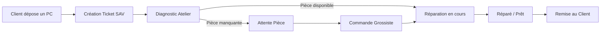
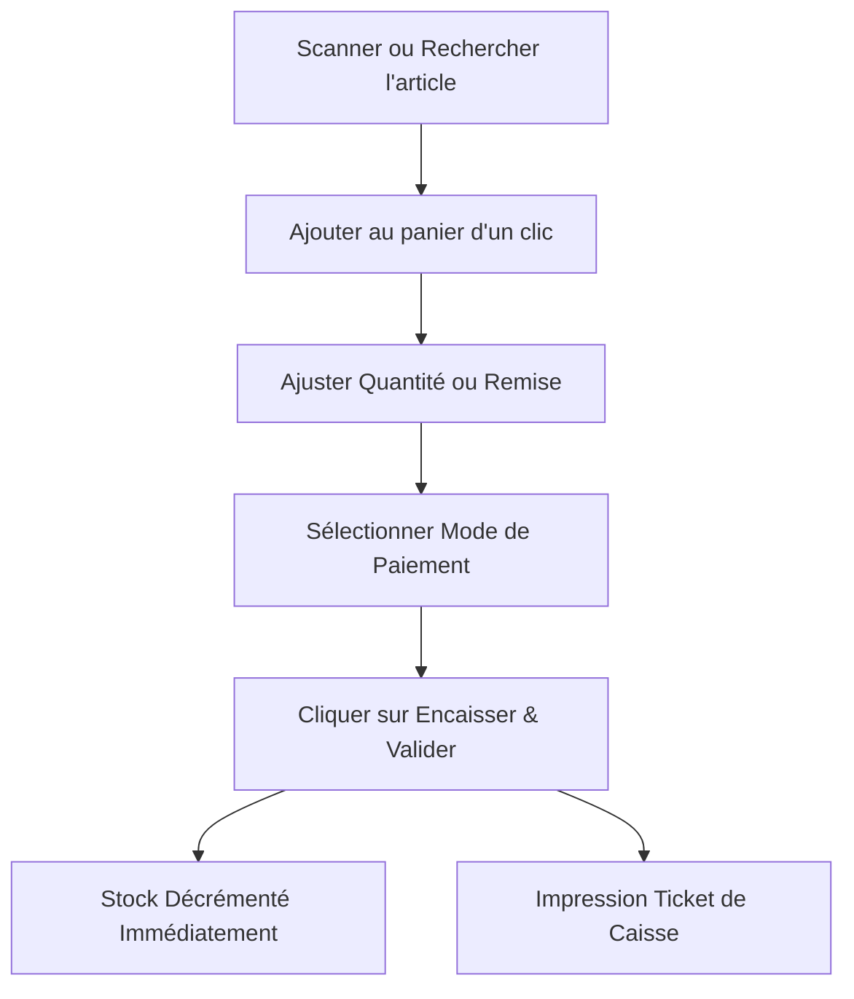

# 📖 Manuel d'Utilisation Officiel : Boutique Informatique & SAV

Ce guide exhaustif détaille l'utilisation quotidienne de l'application **Boutique Informatique & SAV**, spécialement conçue pour la gestion complète d'un magasin de vente de matériel informatique et de son atelier de réparation (SAV).

---

## 📑 Sommaire

1. [Vue d'Ensemble & Architecture](#1-vue-densemble--architecture)
2. [Lancement de l'Application](#2-lancement-de-lapplication)
3. [Interface Générale & Navigation](#3-interface-générale--navigation)
4. [Le Tableau de Bord Atelier (Workflow SAV)](#4-le-tableau-de-bord-atelier-workflow-sav)
5. [Module SAV & Réparations](#5-module-sav--réparations)
6. [Module Inventaire & Stock Informatique](#6-module-inventaire--stock-informatique)
7. [Module Commandes Fournisseurs (Réapprovisionnement)](#7-module-commandes-fournisseurs-réapprovisionnement)
8. [Module Point de Vente & Caisse (Ventes Comptoir)](#8-module-point-de-vente--caisse-ventes-comptoir)
9. [Module Clients & Fournisseurs](#9-module-clients--fournisseurs)
10. [Génération de l'Exécutable Windows (.exe)](#10-génération-de-lexécutable-windows-exe)

---

## 1. Vue d'Ensemble & Architecture

L'application répond à la double activité typique d'un commerce informatique :
- **L'Atelier SAV** : Prise en charge des PC fixes, laptops, imprimantes et composants en panne, suivi des étapes techniques, gestion des pièces de rechange manquantes et restitution aux clients.
- **La Boutique & Caisse** : Gestion du stock de pièces détachées (CPU, GPU, RAM, SSD, écrans...), ventes directes au comptoir avec tickets de caisse et réapprovisionnement auprès des grossistes.



> [!NOTE]
> L'application fonctionne en mode hors-ligne complet (Local-First). Les données sont persistées localement dans votre environnement, garantissant une réactivité instantanée et une utilisation sans connexion internet obligatoire.

---

## 2. Lancement de l'Application

Deux modes d'utilisation sont disponibles selon vos besoins :

### Mode Bureau (Recommandé en magasin)
Lance l'application dans une fenêtre logicielle dédiée (Electron) avec icône dans la barre des tâches Windows :
```powershell
cd C:\Users\benza\Downloads\stock-manager-pro-main\stock-manager-pro-main
npm run electron:dev
```

### Mode Web (Navigateur)
Ouvre l'application dans votre navigateur habituel (Chrome, Edge, Firefox) :
```powershell
npm run dev
```
Accédez ensuite à l'adresse locale : `http://localhost:8080`.

---

## 3. Interface Générale & Navigation

L'écran est structuré de façon ergonomique pour un usage rapide au comptoir ou à l'établi :

- **Barre Latérale Gauche (Sidebar)** :
  - Identité visuelle avec l'icône de l'atelier informatique.
  - Boutons de navigation vers les 7 modules de l'application.
  - Bouton **« Réduire »** en bas pour replier le menu et maximiser l'espace de travail sur les petits écrans.
- **En-tête Supérieur (Header)** :
  - Affichage de la date courante.
  - Champ de recherche globale rapide.
  - Sélecteur de thème **Mode Clair / Mode Sombre** (icône Soleil / Lune) pour le confort visuel lors du travail nocturne en atelier.

---

## 4. Le Tableau de Bord Atelier (Workflow SAV)

Le tableau de bord est le **centre névralgique de votre boutique**. Il a été pensé pour éliminer les données financières superflues et afficher uniquement **l'état réel de la production de l'atelier** : ce qui est réparé, ce qui reste à réparer, et ce qui bloque.

### 4.1 Les 4 Indicateurs Clés Opérationnels

| Indicateur | Signification Métier | Action à mener |
| :--- | :--- | :--- |
| **À Réparer en Atelier** | Nombre d'appareils pris en charge non terminés | Consulter la liste pour organiser la journée des techniciens |
| **En Attente de Pièce** | Appareils bloqués nécessitant un composant non disponible | Vérifier les commandes ou passer commande au grossiste |
| **Réparés · Prêts au Retrait** | Appareils réparés avec succès en attente du client | Contacter le client par téléphone/SMS pour retrait |
| **Pièces en Alerte / Rupture** | Composants du stock épuisés ou sous le seuil d'alerte | Planifier une commande de réapprovisionnement |

### 4.2 Le Pipeline Visuel en 5 Étapes
Au centre du tableau de bord, une barre de progression indique la répartition exacte des appareils :
1. **1. Diagnostic** : Appareils récemment déposés en cours d'évaluation.
2. **2. Attente Pièce** : Appareils diagnostiqués dont la pièce de rechange n'est pas en stock.
3. **3. En Réparation** : Appareils activement démontés / réparés par le technicien.
4. **4. Réparé (Prêt)** : Intervention achevée, appareil testé et prêt à être remis.
5. **5. Livré Client** : Appareils clôturés et restitués.

### 4.3 Gestion Directe depuis le Tableau de Bord
Chaque carte d'appareil sur le dashboard propose des **boutons d'action rapide en un clic** :
- `Diagnostiquer →` : Bascule l'appareil en cours d'analyse technique.
- `Lancer réparation →` : Démarre l'intervention sur l'établi.
- `✓ Marquer Réparé` : Déclare la réparation terminée avec succès.
- `Remettre au client` : Enregistre la livraison de l'appareil au client.

---

## 5. Module SAV & Réparations

Accessible via l'onglet **« SAV / Réparations »** de la barre latérale.

### 5.1 Enregistrer un Nouvel Appareil (Dépôt Client)
1. Cliquez sur le bouton bleu **« Nouvelle réparation »** en haut à droite.
2. Renseignez les coordonnées client :
   - Nom et prénom du client.
   - Numéro de téléphone portable (essentiel pour le prévenir de la fin des travaux).
3. Renseignez les caractéristiques de l'appareil :
   - Type (ex : *Laptop Asus ROG, Tour Gaming, MacBook Air, Imprimante Epson*).
   - Marque, Modèle et Numéro de série (pour la traçabilité).
4. Précisez la **panne signalée par le client** (ex : *Écran noir après chute, ventilateur bruyant, surchauffe et extinction en jeu*).
5. Choisissez le niveau de priorité :
   - `Basse`, `Normale`, `Haute` ou `Urgente` (les urgences s'affichent avec une bordure rouge distinctive).
6. Cliquez sur **« Créer le ticket »**. Un numéro unique est automatiquement généré sous la forme `SAV-2026-0001`.

### 5.2 Mettre à Jour le Suivi Technique
1. Retrouvez l'appareil grâce à la barre de recherche ou aux filtres d'état (*Reçu*, *Diagnostic*, *Attente pièce*, *En cours*).
2. Cliquez sur **« Modifier »** :
   - Notez le résultat du diagnostic technique (ex : *Pâte thermique asséchée + ventilateur CPU bloqué*).
   - Si une pièce spécifique est requise, passez le statut à **« En attente de pièce »** et listez la référence.
   - Indiquez le nom du technicien en charge.
   - Saisissez le coût estimé et le coût final des réparations.

---

## 6. Module Inventaire & Stock Informatique

Accessible via l'onglet **« Inventaire / Stock »**.

### 6.1 Structure du Catalogue
Le stock est configuré spécifiquement pour le matériel informatique avec les catégories suivantes :
- `CPU`, `RAM`, `GPU`, `SSD`, `HDD`, `Carte mère`, `Alimentation`, `Boîtier`, `Refroidissement`
- `Écran`, `Clavier`, `Souris`, `Câble`, `Réseau`, `Laptop`, `Desktop`, `Accessoire`, `Autre`

### 6.2 Ajouter une Référence
1. Cliquez sur **« Ajouter un article »**.
2. Remplissez les champs nécessaires :
   - **Désignation** : Nom précis (ex: *SSD Kingston NV2 1TB NVMe PCIe 4.0*).
   - **Catégorie & Marque** : Pour les filtres automatiques.
   - **Emplacement atelier** : Rayon ou tiroir de rangement (ex: *Tiroir B3*).
   - **Quantité en stock** et **Seuil d'alerte** : Si le stock passe sous ce seuil, le produit passe en statut `Stock faible` automatiquement.
   - **Prix d'achat** et **Prix de vente**.
3. Validez : une référence unique (`STK-00001`) est générée.

### 6.3 Statuts Automatiques de Stock
- 🟢 **En stock** : Quantité supérieure au seuil d'alerte.
- 🟡 **Stock faible** : Quantité inférieure ou égale au seuil de sécurité configuré.
- 🔴 **Rupture** : Quantité tombée à zéro.

---

## 7. Module Commandes Fournisseurs (Réapprovisionnement)

Accessible via l'onglet **« Commandes »**.

Ce module permet de reconstituer le stock des pièces vendues ou nécessaires pour débloquer les réparations de l'atelier.

### 7.1 Passer une Commande
1. Consultez la bannière d'alerte orange en haut de page qui liste les composants épuisés.
2. Cliquez sur **« Nouvelle commande »**.
3. Sélectionnez le grossiste / fournisseur partenaire.
4. Ajoutez des lignes de commande :
   - Vous pouvez directement sélectionner un composant depuis votre stock existant pour préremplir sa référence et son prix d'achat grossiste.
   - Indiquez la quantité commandée.
5. Définissez la date de livraison estimée et validez la commande (`CMD-2026-0001`).

### 7.2 Suivi & Réception
- Changez l'état au fur et à mesure : `Brouillon` ➔ `Envoyée` ➔ `En transit` ➔ `Reçue`.
- Cliquez sur une ligne de commande dans le tableau pour dérouler son détail et pointer les quantités reçues.

---

## 8. Module Point de Vente & Caisse (Ventes Comptoir)

Accessible via l'onglet **« Ventes / Caisse »**.

Conçu pour accélérer les encaissements directs en boutique.



### 8.1 Effectuer une Vente
1. Dans l'onglet **« Nouvelle vente (Caisse) »** :
   - Utilisez la barre de recherche pour trouver la pièce (CPU, SSD, Câble HDMI, etc.).
   - Cliquez sur **« Ajouter »** : l'article s'insère instantanément dans le panier à droite.
2. Ajustez si besoin la quantité ou appliquez une remise en DZD.
3. Sélectionnez le client (ou laissez *Client Comptoir* pour les ventes anonymes).
4. Choisissez le mode de règlement : **Espèces**, **Carte**, ou **Virement**.
5. Cliquez sur **« Encaisser & Valider »** :
   - Le stock est **automatiquement débité** en arrière-plan.
   - Une fenêtre d'aperçu de facture / ticket de caisse s'ouvre avec le bouton **« Imprimer Ticket »**.

### 8.2 Historique & Factures
Dans l'onglet **« Historique »**, retrouvez toutes les ventes passées, filtrez par mode de règlement, et réimprimez n'importe quelle facture à la demande.

---

## 9. Module Clients & Fournisseurs

### 9.1 Fiches Clients
- Distingue les **Particuliers** et les **Entreprises** (avec champ raison sociale / société).
- Mémorise les numéros de téléphone et le cumul historique de leurs achats.
- Permet de lier directement les tickets de réparation SAV au dossier du client.

### 9.2 Fiches Fournisseurs (Grossistes Informatiques)
- Enregistrement des grossistes (nom, contact commercial, téléphone, ville).
- Paramétrage du **délai moyen de livraison** (ex : 3 jours) et des conditions de règlement.
- Affichage direct du nombre de commandes associées à chaque fournisseur.

---

## 10. Génération de l'Exécutable Windows (.exe)

Pour installer l'application sur un ordinateur de caisse ou un poste d'atelier sans avoir besoin d'ouvrir de terminal :

```powershell
cd C:\Users\benza\Downloads\stock-manager-pro-main\stock-manager-pro-main
npm run electron:build
```

Le programme d'installation autonome au format `.exe` sera généré dans le sous-dossier `release/`. Vous pourrez le copier sur une clé USB et l'installer sur n'importe quel PC Windows.

---

> [!TIP]
> **Conseil pour le travail d'équipe en atelier :**
> À chaque arrivée le matin, commencez par consulter le Tableau de bord avec le filtre **« Attente Pièce »** pour voir si les colis du jour débloquent des réparations, puis basculez sur le filtre **« Urgents »** pour prioriser le travail des techniciens.
